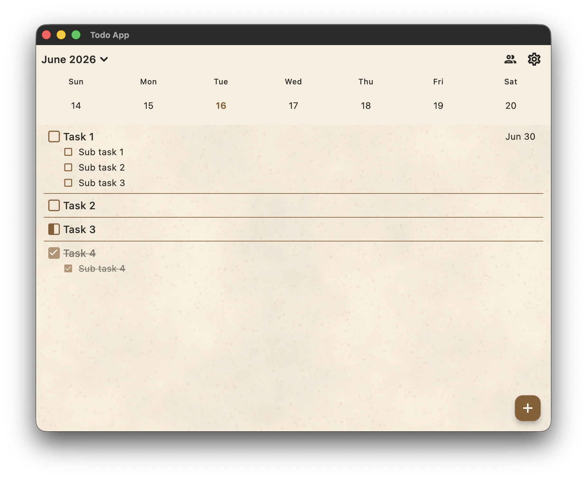
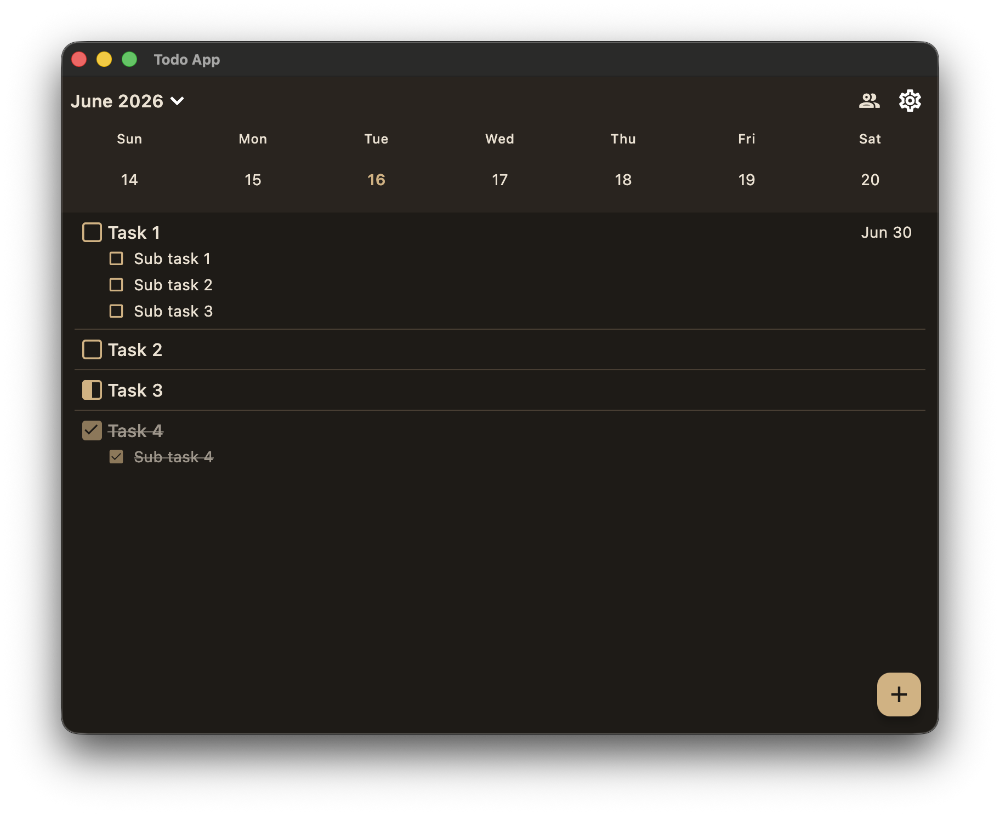
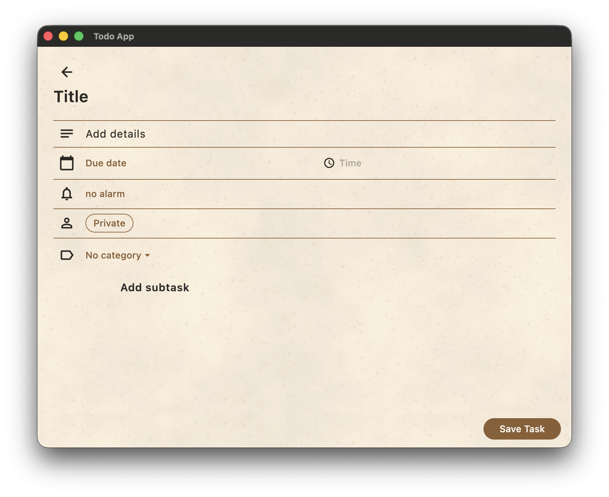
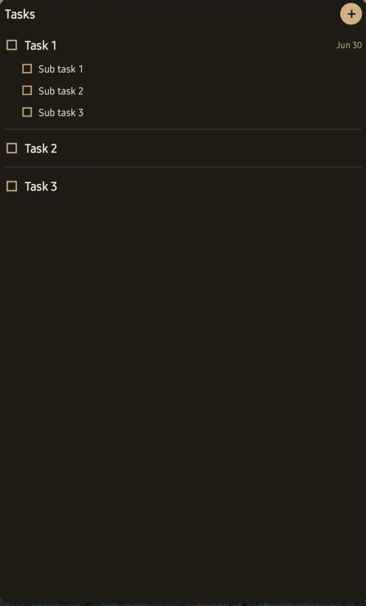
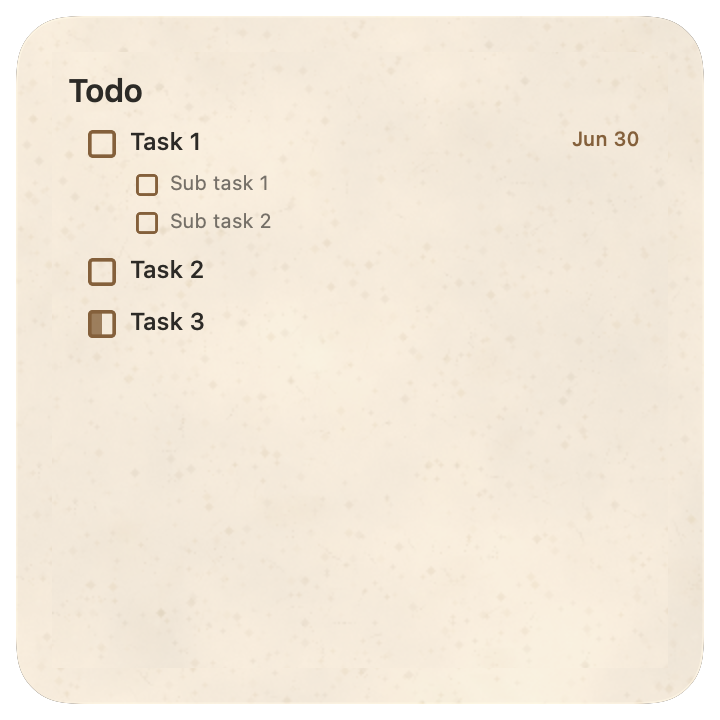
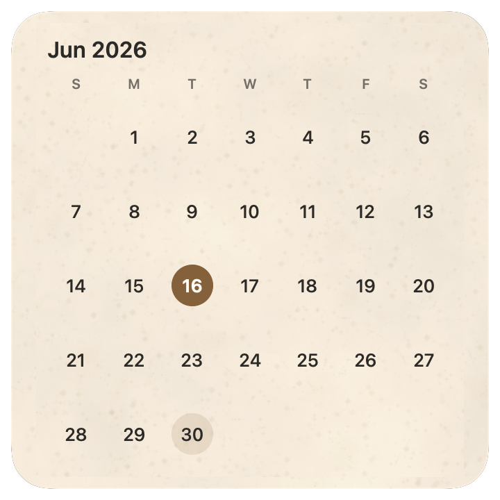

# Personal Todo

[English](README.md) | **한국어**

Mac, Android, iOS, 웹에서 두 사람이 함께 쓰는 할 일 앱입니다. 기능이 너무 많거나 쓸 만한 기능이 너무 적은 기존 앱이 불편해서 저와 파트너가 쓰려고 만들었습니다.

| 라이트 모드 | 다크 모드 | 작업 편집 |
| :---: | :---: | :---: |
|  |  |  |

| Android 위젯 | Mac 할 일 위젯 | Mac 캘린더 위젯 |
| :---: | :---: | :---: |
|  |  |  |

## 주요 기능

- **오프라인 우선 동기화**: 변경 사항은 기기에 먼저 저장되고, 연결되면 업로드됩니다.
- **공유 완료**: 작업마다 한 명만 완료하면 되는지, 두 사람 모두 완료해야 하는지 정할 수 있습니다.
- **하위 작업**: 순서가 있는 하위 작업이 상위 작업과 함께 동기화됩니다.
- **위젯**: Android, macOS, iPhone 위젯에서 앱을 열지 않고 작업을 완료할 수 있습니다.
- **알림**: Android와 Apple 기기에서 사용할 수 있습니다.

## 기술 스택

| | |
| --- | --- |
| 앱 | Flutter, SQLite(`sqflite`), 로컬 동기화 큐 |
| 서버 | FastAPI, PostgreSQL, SQLAlchemy |
| 배포 | Docker Compose, Caddy(HTTPS) |

## 지원 환경

| 플랫폼 | 최소 버전 | 위젯 |
| --- | --- | --- |
| Android | 8(API 26) | 지원 |
| iOS | 15 | 체크박스는 iOS 17 이상 필요 |
| macOS | 12 | 데스크톱 위젯은 macOS 14 이상 필요 |
| 웹 | 최신 Safari 또는 Chrome | 네이티브 위젯 미지원 |

## 시작하기

`<your-domain>`을 자신의 도메인으로 바꾸세요.

1. **서버 배포**: Docker가 설치된 VPS와 도메인이 필요합니다. [배포 문서](server/deploy/README_ORACLE_VM.md)를 참고하세요.
2. **클라이언트 빌드**: Android 앱을 빌드하려면:

   ```sh
   flutter build apk --dart-define=TODO_API_BASE_URL="https://<your-domain>"
   ```

   웹 앱을 빌드하려면:

   ```sh
   bash scripts/build_web.sh
   ```

   `build/web/` 배포 방법은 배포 문서를 참고하세요. 네이티브 앱에서는 로그인 화면에 서버 주소를 직접 입력할 수도 있습니다.
3. **로그인**: `server/.env`의 `USER1_PASSWORD` 또는 `USER2_PASSWORD`를 사용해 `user1` 또는 `user2`로 로그인합니다.
4. **iPhone/iPad 설치**: Safari에서 `https://<your-domain>/app/`을 열고 공유 → 홈 화면에 추가 → 웹 앱으로 열기를 선택하세요. 매주 서명을 갱신할 필요가 없습니다.

## 참고 사항

- 앱이 열려 있으면 30초마다 변경 사항을 확인합니다. 네이티브 앱은 약 2시간마다 백그라운드 갱신을 요청하지만, 운영체제가 이를 늦추거나 건너뛸 수 있습니다.
- 웹 앱은 처음 온라인으로 열고 나면 오프라인에서도 사용할 수 있고, 열려 있을 때와 다시 열 때 동기화합니다. 위젯과 예약 알림은 네이티브 앱에서 사용합니다.
- 완료 작업 보관 기간 설정은 기기마다 따로 저장되므로, 소유자의 모든 기기에서 같은 값으로 맞추세요.
- 완료한 작업을 휴지통으로 자동으로 옮기는 것은 소유자만 할 수 있습니다. 휴지통은 30일 동안 보관됩니다.
- Android에서 정확한 알람을 사용할 수 없으면 부정확한 알림으로 대신 예약하고, 설정에 경고를 표시합니다.
- 세션이 만료되면 로그인 화면이 열립니다. 저장된 작업과 대기 중인 변경 사항은 그대로 유지됩니다.

## 더 보기

- [백엔드](server/README.md): 동기화 프로토콜, 로컬 개발, 테스트
- [배포](server/deploy/README_ORACLE_VM.md): 설정, 업그레이드, 웹 호스팅, 백업
